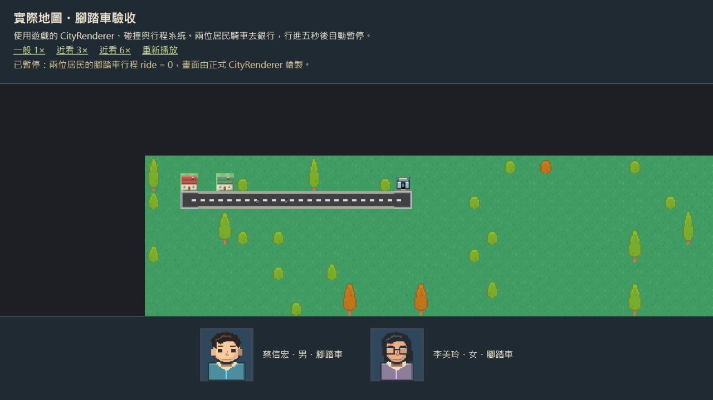
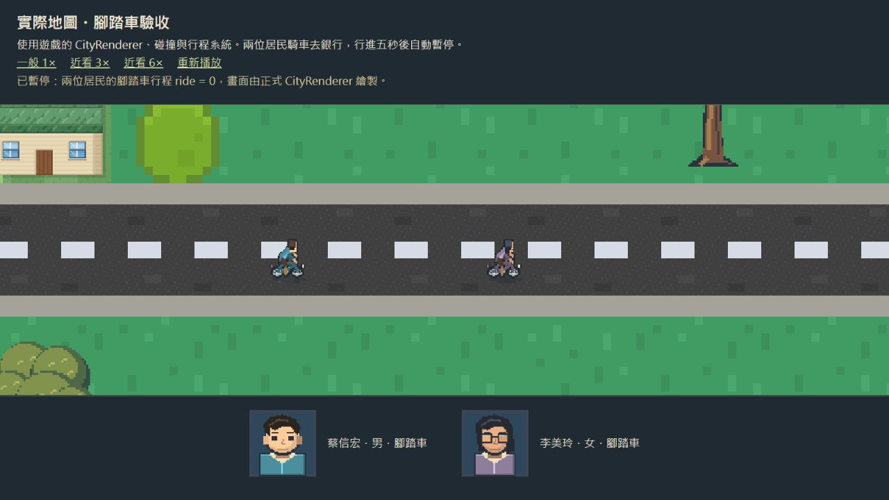

# 腳踏車缺席修正與縮放美術研究

日期：2026-11-23。使用者要求完成後推送並提供報告。

## 結果與本輪範圍

本輪修正腳踏車「有素材、實際行程卻看不到」的原因，保留已認可的人物、騎士與單車畫風。另完成縮放美術研究與下一批製作建議；尚未把研究建議當作已完成的新建築素材或已實作的 LOD 過渡。

## 為什麼前一版改倍率仍沒有解決

1. `VisitSystem.ts` 的日常外出規則原本只准機車／汽車，明確讓腳踏車留在家。先前修改 1× 顯示倍率，只處理到繪製門檻。
2. 腳踏車使用交通工具代碼 `0`，步行應為 `undefined`。規劃器保存、街景抽樣、道路流量及行人排除等流程卻使用真假值判斷，將 `0` 當成無交通工具。
3. 存檔解析器不接受 `ride: 0`，無法保存這類行程。
4. 即使有單車行程，有限的外出車輛顯示名額也可能先被較早列出的機車／汽車占滿。
5. 城市「車子」統計原本直接跳過第 0 項，連腳踏車持有數量都沒有列出；因此也無法從面板確認目前是否有單車居民。

## 已修正

- 較遠的日常外出可使用居民的腳踏車。未保存 `car` 欄位代表預設腳踏車，不能當成沒有交通工具。
- 所有相關流程明確區分 `ride === undefined` 與 `ride === 0`；行程、返程、保存與還原不再丟掉單車代碼。
- 步行速度維持原有基準；單車為步行的 1.8 倍，與通勤單車一致。短路程仍走路，雨天的短程單車行程遵守原有改步行規則。
- 街景在原有總名額內，保留一格給真實單車行程，不產生虛構交通或把汽機車換皮。沒有單車候選時不假造一台；其餘多數居民仍依原有有界抽樣顯示。
- 存檔升至 v13，支援 v1–12；原有性別、姓名、財產與途中進度不重設。
- 城市「車子」統計加入腳踏車數量，顯示真實持有狀態；腳踏車不收牌照稅。成熟城市若居民已升級交通工具，可以直接從面板區分「沒有單車候選」與「圖未畫出」。
- 未修改單車圖集大小、碰撞尺寸、跟車與路口許可，也未重新生成另一種畫風。

## 實際繪製驗收

加入可重複執行的 `tools/bicycle-city-check.html`。兩名固定居民、真實道路與 `ride: 0` 銀行行程，直接使用正式 `CityRenderer`、`SimulationClock`、`VisitSystem`、碰撞與同一套素材；沒有另寫展示用的單車畫法，也不寫入玩家存檔。五秒後自動暫停，方便比對。

這是刻意固定人物與行程的整合場景，不代表已逐一檢查所有玩家存檔；另外的規劃器與中型示範城市測試確認正常排程也會產生單車行程。

- 一般 1× 可見兩位騎士及單車。
- 6× 可辨認車架、輪組、男女騎士與對應頭像。
- 瀏覽器沒有 JavaScript error。
- 前一批被原生確認視窗阻擋的「實際渲染器目視驗收」缺口，本輪以不需要覆蓋城市確認的整合頁補上。

## 研究：如何讓放大自然顯露細節

### 來源所支持的做法

- Factorio 的圖示工作流程先完成最高解析度原稿，再縮小並人工調整各尺寸；這篇談的是圖示，適合借用其製作方法，不能直接宣稱其所有建築都採相同流程。[FFF-348：The final GUI update](https://www.factorio.com/blog/post/fff-348)
- Valve 的角色美術指南強調輪廓、明暗與細節層級；太小的細節會變成雜訊，複雜區域需要大面簡潔區域平衡，低對比細節可避免搶走注意力。[Dota 2 Character Art Guide](https://help.steampowered.com/en/faqs/view/0688-7692-4D5A-1935)
- Unity 的 LOD 過渡文件示範在一段範圍內漸變，避免瞬間切換。這是 3D 引擎的參考，並非本遊戲可直接套用的功能；2D 圖集仍需自行實作及檢查重影。[LOD transitions](https://docs.unity.com/en-us/engine/7000.0/manual/analysis/graphics-performance-profiling/lod/lod-group/lod-transitions-lod-group)
- Factorio 的串流設計使用縮小版本，按當前縮放需求載入，說明精緻原稿與記憶體控制可以並行。[FFF-264：Texture streaming](https://www.factorio.com/blog/post/fff-264)

### 本專案目前的限制

`tools/draw_tiles.py` 的主要建築設計起於 16×16 格，`draw_tiles_hd.py` 放大原始色塊並增加表面材質。這能改善紋理解析度，卻讓立體結構受原始粗格限制；更多磚縫、刻線不會自然變成更好的屋簷厚度、窗戶凹入感與門廊體積。使用者指出的落差成立。

另一個原因是遠近圖在固定縮放門檻切換；若形體、描邊、對比或光影不同，就會產生突然換了一種畫法的感覺。只加入淡入淡出無法解決造型本身不一致。

### 建議的製作順序（研究結論，尚未實作）

1. **先做完整原稿。** 每棟在足夠的作者畫布上先完成輪廓、主體積與光影，再處理材質。先沿用現有 128px／格預算做代表建築，驗證後才決定是否真的需要更大的圖。
2. **細節先分層。** 大層：屋頂、樓體、入口、投影；中層：屋簷、窗框、陽台、門廊和設備；小層：接縫、招牌文字與細紋。中層結構應在一般倍率就建立造型，不等到近看才突然出現。
3. **由同一原稿產生遠近版本。** 保持占地、輪廓、門窗位置、配色、光源與落地點一致；縮小版本只合併過小的細節，不能換成另一棟通用建築。必要的人工修正集中在縮小後的可讀性。
4. **最後才處理過渡。** 確認兩版已像同一棟建築，再測試窄範圍的漸變或細節對比過渡，逐一排除雙邊線、重影與像素閃動。保留清晰的像素邊緣，不以整幅模糊掩蓋問題。
5. **同時驗收 1×／3×／6× 與連續縮放。** 先做住宅、商店與公共建築的前後對照；保留每棟原來的身分與四種城市風格。人物和單車以使用者已接受的兩張參考為準，不連帶重畫。
6. **維持按需載入。** 一次保留當前城市風格，先載小版本，較高解析版本準備好再銜接，避免再次出現四張大圖同時載入的負擔。

## 測試

- 全套一般回歸：66 檔／263 項通過。
- 另補兩項街景顯示名額測試，確認機動車優先列出時仍可顯示真實單車，且不超過上限、不假造單車。
- 規劃器測試確認預設持車狀態能產生 `ride: 0` 銀行行程並存讀檔；中型城市測試確認正常排程中確有單車。
- 城市長模擬：CityBalance 三項通過，涵蓋三種規模、兩個種子、月結、存讀檔重播與道路中斷。
- 正式建置通過：三座示範城市重建、模擬及前端 TypeScript、Vite 打包。既有大型 bundle 提示保留，未調高門檻。
