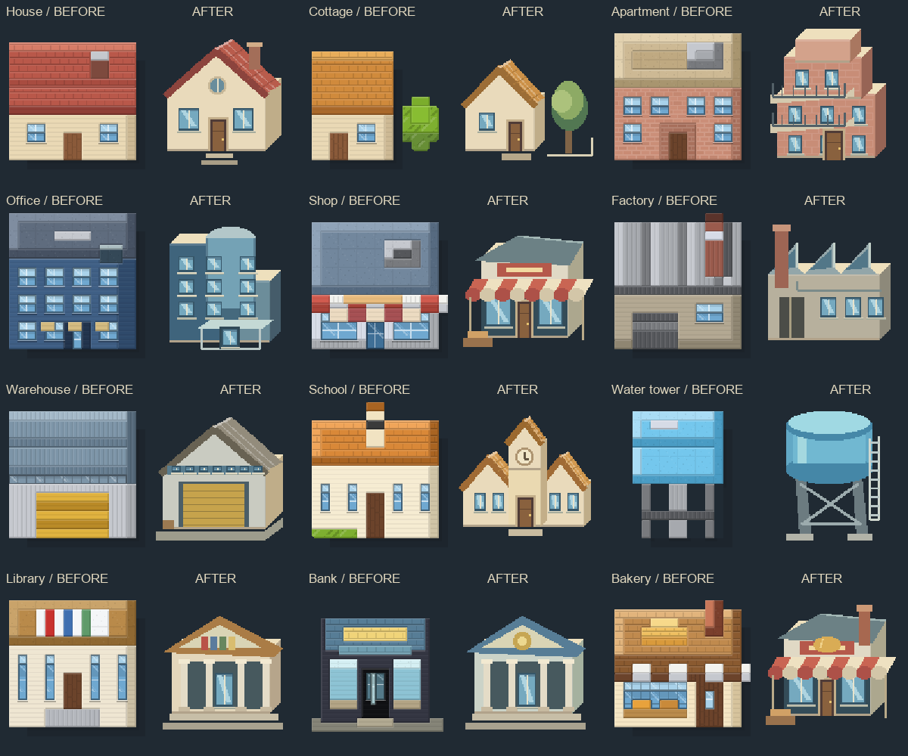

# 建築外型差異化：第一批

日期：2026-11-24。改前對照：`4dd3050`。

## 結果

本批將建築的外輪廓、屋頂、退縮、分翼與負空間拉開差異。使用者確認 15 款量體草案後，才繼續細化並接入正式圖集。固定舊方形輪廓的表面實驗沒有發布；本報告只記錄新的外型成果。

- 住宅：斜屋頂住宅、L 形別墅、帶樹庭院小屋、雙拼連棟、平頂工人住宅、架高河岸住宅，以及帶陽台的退縮公寓與高樓。住宅類型、等級及部分配色有不同組合。
- 商業：騎樓與圓弧雨棚的小店、多層退縮百貨、帶圓形量體的商辦，保留玻璃、入口與招牌區分。
- 工業：鋸齒採光屋頂廠房、斜頂倉庫、圓筒儲槽；卷門、採光帶、管線與煙囪分別屬於相應外型。
- 公共建築：圓筒水塔、鐘樓分翼學校、診所、柱廊圖書館與銀行、市政廳旗幟、曲簷廟宇，以及部分社區商店。
- 大型建築：開放中庭住宅群、分翼醫院與大學、穹頂博物館、橢圓體育場，保留原 2×2 占地。

四套城市配色各更新原有 127 個建築框格中的 **108 個**，共 432 個外觀框格；這不是 432 種獨立建築。實際映射及外型家族見 [manifest.json](../design-assets/buildings/manifest.json)。

## 外型與原稿對照



[原稿 → 1×／3×／6×](../design-assets/buildings/master-to-game.png) · [經典全部框格](../design-assets/buildings/all-buildings-classic.png) · [舊金山](../design-assets/buildings/all-buildings-sf.png) · [加州](../design-assets/buildings/all-buildings-california.png) · [紐約](../design-assets/buildings/all-buildings-newyork.png)

## 製作與整合

使用程式原生幾何繪製 256px 原稿，大型建築為 512px；先處理建築量體、屋頂和輪廓，再加入窗洞、窗台、屋脊、門框、陽台與局部磚面。沿用柔和配色及明確的像素邊緣，沒有影像生成，也沒有將舊的低解析圖放大充當新原稿。

原稿縮為既有 128px／大型 256px 近看框格，一般視角再由同源外觀縮為 32px／大型 64px。四城市風格套用原有配色、飾邊與屋頂／逃生梯規則。建築的外輪廓允許改變，地圖占地、圖集位置、定位方式、模擬與存檔不變。

繪製仍使用正式 CityRenderer／TileRenderer 的貼圖流程；沒有新增遊戲畫布或每幀建模。原稿僅保存在設計文件目錄，不匯入遊戲。

## 檢查與素材成本

- 432 個更新外觀框格的縮小來源一致；108 個經典原稿均不碰裁切邊界，其他風格保持原有圖集框格。
- 四風格各 108 個框格的透明輪廓確實改變，符合此次外型需求；沒有再要求等於舊的矩形輪廓。
- 未更新的 19 個特殊框格逐像素保留；道路、空地和 park／farm／viaduct 概覽圖示也逐像素保留。
- 中庭草地有獨立檢查，避免再次被當成屋頂紋理。
- 四城市另檢查玻璃與反光的顏色保護，避免反光被當成牆面重新配色。
- 獨立像素審查 PASS：人工 88 分、四張代表 native 圖自動平均 95 分。審查涵蓋前後對照、原稿縮放圖、四城市縮圖和四張 native 圖，並非逐幀人工認證。詳見 [art-review.json](../design-assets/buildings/art-review.json)。

一般圖集仍為 512×544，近看圖集仍為 2048×2176；每套近看解碼 RGBA 仍為 **17 MiB**，既有單一主題按需載入與地圖快取不變。八張遊戲 PNG 合計由 1,783,924 bytes 降至 1,318,468 bytes，減少約 26.1%；這是檔案體積，不能換算成 FPS 提升。[原始檢查資料](../design-assets/buildings/verification.json)。

本輪沒有實體平板 FPS 測試，不宣稱特定裝置效能提升。

## 保留及後續項目

19 個框格仍使用已發布外觀：發電廠、消防局、警察局、公車站、捷運站、市場、電影院、停車場、游泳池、KTV、購物中心、賭場、遊樂園、廣場、回收場、加油站、社區中心、長照中心、紀念公園。部分本來就是開放場地，後續需按用途個別設計。

同類商辦與工業仍有重複外型，圖書館／銀行的差異依賴書本與硬幣符號，紐約逃生梯在小窗面上較密；這些列為下一輪差異化與可讀性調整，不記為已全部完成。

## 重製

```powershell
python tools/building_masters.py
python tools/check-building-masters.py
```

需要 Python、Pillow、NumPy，一般遊戲打包不執行作者工具。若重跑歷史 `draw_tiles.py`／`draw_tiles_hd.py`，必須最後再執行新的原稿產生器。細節見 [素材說明](../design-assets/buildings/README.md)。

`/tools/building-city-check.html` 可在同一範例城市切換城市風格、1×／3×／6× 與建築區域；頁面使用正式渲染器、已暫停，不寫入玩家存檔。

本輪一般回歸測試 69 檔、270 項通過；最終外型 PNG 已通過原稿與框格檢查，以及正式 `npm run build`（範例城市、兩組 TypeScript、Vite 打包）。沒有重跑長時間模擬群。仍有原本主 JavaScript chunk 超過 500 kB 的提示。

正式渲染器截圖：[經典 3×](../design-assets/buildings/live-exteriors-classic-3x.jpg)、[經典 6×](../design-assets/buildings/live-exteriors-classic-6x.jpg)、[舊金山 6×](../design-assets/buildings/live-exteriors-sf-6x.jpg)、[加州 1×](../design-assets/buildings/live-exteriors-california-1x.jpg)、[加州 6×](../design-assets/buildings/live-exteriors-california-6x.jpg)、[紐約 6×](../design-assets/buildings/live-exteriors-newyork-6x.jpg)。
