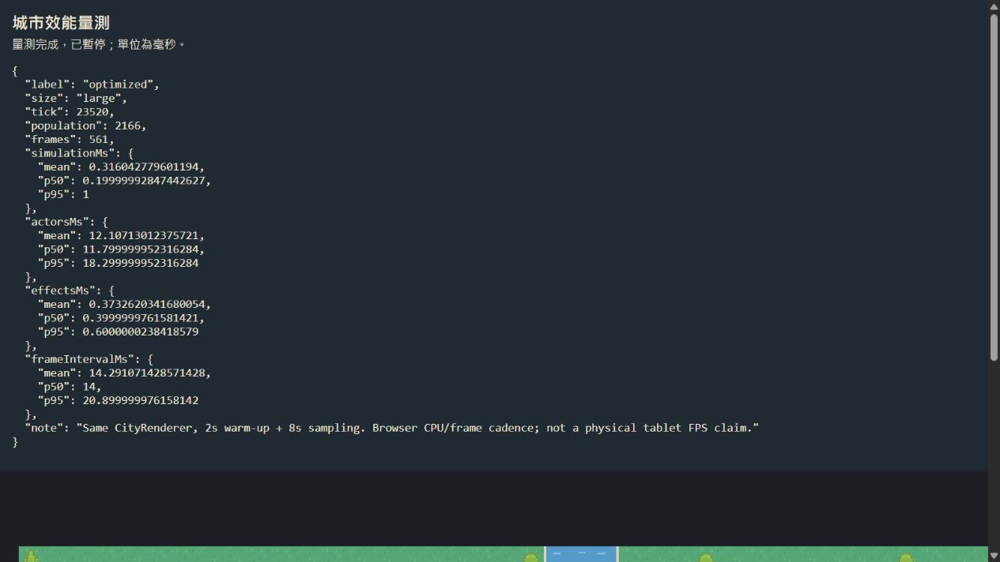

# 城市卡頓：路徑與碰撞運算優化

日期：2026-11-24（台灣時間）。CPU 基準版本：`b31221d`；實際開工時主分支已包含 `608474a` 的每幀最多三段駕駛更新修正，本輪保留該修正。兩版的 CPU 基準所用 `RoadOccupancy.ts` 與 `commuterPosition.ts` 相同。

## 完成內容

1. **通勤路徑幾何快取**：車道、行人側移與道路轉角的座標，在每段行程建立一次；碰撞、朝向與繪製取樣直接插值。路徑、起訖點、交通方式或往返方向改變時重建。快取隨行程釋放，沒有新增全城市永久素材庫。
2. **碰撞位置重用**：完整掃描移動路徑時，前一次已確認的位置直接作為下一次起點；遇到障礙進行二分搜尋時也重用已確認的車體。維持原本每 0.025 格取樣、轉向檢查、車身尺寸、安全間距與二分搜尋精度。
3. **外出驗路快取**：同一路徑在道路版本不變時重用驗證結果，省去每 100 毫秒複製並掃描整條路徑。拆路、重建道路與讀取地圖後重新檢查；居民是否仍存在、目的地是否被拆除仍每次確認。以 WeakMap 保存，不保留已結束的路徑。
4. **可重跑的量測工具**：新增純 CPU 基準與使用實際 CityRenderer 的瀏覽器量測頁。正常遊戲沒有開啟逐幀計時資料收集。

本輪沒有修改人物、建築或腳踏車美術，也沒有提高車速、減少碰撞取樣或取消交通規則。

## CPU 基準結果

固定 500 輛車、60 幀、相同初始位置與移動目標，各版本先暖機一次，再量五次並取中位數。舊版碰撞程式由 Git 基準版本直接讀取，搭配舊版路徑座標計算；新版使用本輪程式。依序執行，沒有與測試或打包同時跑。

| 工作負載 | 舊版 | 新版 | 耗時減少 |
| --- | ---: | ---: | ---: |
| 路徑取樣＋車體朝向＋碰撞推進 | 241.11 ms | 174.21 ms | 27.7% |

兩者最終位置總和同為 `18149.999999999975`。原始五次數據在 [traffic-cpu.json](../design-assets/performance/traffic-cpu.json)。這是指定交通運算的改善，**不能換算為整個遊戲或平板 FPS 提升 27.7%**；此基準也沒有量測驗路快取的效益。

## 瀏覽器檢查

載入相同大型範例城市（人口 2166、存檔 tick 23520），實際 CityRenderer、1×、一般地圖模式，先暖機 2 秒，再收集 8 秒；結束後自動暫停。

| 新版更新階段 | 平均 | 第 95 百分位 |
| --- | ---: | ---: |
| 模擬推進 | 0.32 ms | 1.00 ms |
| 人物／車輛更新與繪圖指令 | 12.11 ms | 18.30 ms |
| 事件效果 | 0.37 ms | 0.60 ms |
| 幀間隔 | 14.29 ms | 20.90 ms |

收集 561 幀，沒有瀏覽器 JavaScript 錯誤。原始數據在 [optimized.json](../design-assets/performance/optimized.json)，驗證畫面如下。

第一輪舊版瀏覽器只有 13 幀，幀間隔約 660 ms，樣本量與後續量測差異太大，可能受背景分頁節流或載入環境影響，**不採用來計算加速百分比**；仍保存 [baseline.json](../design-assets/performance/baseline.json) 供查核。

瀏覽器測的是本機開發環境的 CPU 與幀節奏，不包含完整 React 操作成本、獨立 GPU 計時或實體平板測試。人口更多、放大顯示大量素材、交通疊圖與核心模擬更新時仍可能出現尖峰。

## 驗證與重跑

- 新舊座標對照涵蓋直路、轉角、折返、行人／車道、去程／回程與邊界進度，共 12,036 組位置。
- 驗路測試涵蓋快取命中、拆路、重建與載入；真實行程回歸確認拆路和拆目的地均立即取消行程。
- 既有道路測試覆蓋長幀防穿車、交叉路口、轉向、舊存檔重疊分離與混合尺寸車隊排隊。
- `npm run test:fast`：69 個檔案、268 項測試通過；之後補入「同一個路徑物件改變終點」測試，重跑幾何測試 2 項通過，合計涵蓋 269 項不同測試。
- `npm run build`：範例城市產生、兩組 TypeScript 檢查與 Vite 正式打包全部通過。仍有原本的單一 JavaScript chunk 超過 500 kB 提示；本輪沒有調整分包。
- `git diff --check` 通過。未重跑長時間模擬測試群，也尚未在實體平板驗證。

重跑交通基準：`node tools/benchmark-traffic.mjs`。需要保留 Git 基準提交 `b31221d`。

重跑瀏覽器量測：先啟動 Vite 開發伺服器，再開啟 `/tools/performance-check.html?size=large&label=optimized`。頁面直接讀取範例城市，不會覆蓋玩家存檔。請讓機器保持閒置，量測時不要同時執行測試或打包。
