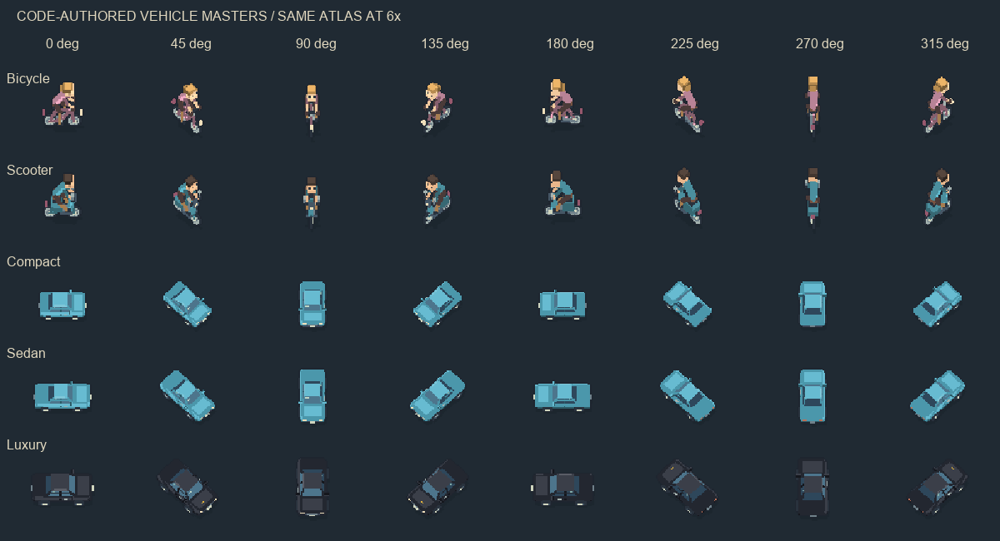

# 居民交通工具：精緻原稿與自然縮放

日期：2026-11-24。依使用者核准的「先完成精緻原稿，再縮小修正可讀性」方式製作。

## 交付範圍

- **汽車**：從程式立體原稿重建輪拱、輪圈、分離的車艙／前蓋／後廂、斜面玻璃、門縫、後視鏡、頭尾燈、保險桿與車牌。三個尺寸各有座艙比例，保留原有一般色、高級色及紐約計程車規則。修正車身換色會誤染部分玻璃的選色方式。
- **腳踏車**：保留原先認可的外形、人物比例與配色，以較密的原稿重新繪製輪圈、輻條、圓管車架與騎姿接點；仍有兩個由移動距離驅動的踏板姿勢，不會停車時空踩。
- **機車**：補上完整的踏板式機車結構，包含前後輪、座墊、踏板、前車殼、車燈、把手與後視鏡；24 個居民外觀與人物卡資料對應。雙腳固定放在踏板，不套用腳踏車踩踏姿勢。外送員使用相同機車，另保留配送箱，並修正外送車頭方向與騎士外觀對應。
- **縮放一致**：0.85× 以上的汽車、單車與機車均使用同一份烘焙圖集，正常倍率與放大看到的是同一車體，不再在 1.75× 把矩形汽車替換成另一種外形。小於 0.85× 保留原有城市概覽標記。

本輪完成居民交通工具這一批。建築、貨車、公車／捷運與其他物件尚未依這次原稿流程更新，不能視為全城美術已完成。

## 如何製作

沿用本機 pixel-art-studio 的原配色與獨立美術審查，以及專案 sprite-stacking 的固定支點、nearest 取樣與烘焙原則。沒有使用影像模型。

汽車原稿為 48×88×48 體積，腳踏車／機車為 28×64×88 體積。圓形、管件與車身斜面在原稿網格上直接計算，沒有把舊 PNG 放大後疊上噪點。先輸出 192px 汽車或 128px 二輪車的方向原稿，再以 nearest 縮至 96px／64px 遊戲 frame，最後對縮小後的完整輪廓描一次外框。

四個診斷視圖、切片和各方向來自同一體積。所有方向保持固定畫框和地面支點，不依可見內容逐張置中。遊戲只載入小圖集，不載入原稿，也不即時堆疊切片。

原稿：[汽車轉盤](../design-assets/car/car-master-turntable.png)、[腳踏車轉盤](../design-assets/bicycle/bicycle-master-turntable.png)、[機車轉盤](../design-assets/vehicles/scooter-master-turntable.png)。

## 實際輸出

下圖直接使用最後輸出的遊戲圖集，由上到下為腳踏車、機車、小汽車、轎車及高級車；每列顯示八方向。素材實際包含 16 方向。瀏覽器另外使用正式 CarSprites／BicycleSprites 檢查縮放，截圖保存在下方連結。



[1× 對照](../design-assets/vehicles/zoom-1x.jpg) · [3× 對照](../design-assets/vehicles/zoom-3x.jpg) · [6× 瀏覽器對照](../design-assets/vehicles/zoom-6x.jpg) · [真正城市中的機車](../design-assets/vehicles/live-scooter-6x.jpg) · [真正城市中的腳踏車](../design-assets/vehicles/live-bicycle-6x.jpg)。瀏覽器檢查後另修整機車的完整胎圈，最終像素以本頁主圖與 PNG 為準。

## 素材成本與檢查

| 遊戲圖集 | 幀數 | 解碼 RGBA 大小 | 與原版比較 |
| --- | ---: | ---: | --- |
| 汽車 | 432 | 15.19 MiB | 圖集尺寸不變 |
| 腳踏車 | 800 | 12.50 MiB | 圖集尺寸不變 |
| 機車 | 400 | 6.25 MiB | 新增，見到機車時才載入 |

每個物件仍使用一次貼圖繪製；frame texture 持續快取。機車有共享載入引用與卸載處理，城市銷毀或載入被中止時釋放引用。新增機車不是免費的，解碼後約增加 6.25 MiB；三套 PNG 相較舊汽車＋單車合計增加約 302 KiB。

`python tools/check-vehicle-art.py` 驗證全部 1,632 幀的尺寸、非空、四邊不裁切及透明度；只接受透明、既有地面陰影 55 與不透明 255，沒有模糊邊緣。數據見 [atlas-check.json](../design-assets/vehicles/atlas-check.json)。

另外檢查機車兩個輪圈的完整圓周，避免移除舊腳踏車曲柄時誤切前輪。

獨立像素審查 PASS、人工調整分數 83，沒有阻擋問題。自動平均 50 分對深色外框、輪胎及車燈的 pillow shading／孤立像素提出警示；審查者對照實圖判定為此類遊戲尺寸的誤判，詳見 [art-review.json](../design-assets/vehicles/art-review.json)。尚可改善的項目是深色高級車與輪胎的對比，以及側面腳踝／踏板群組的辨識度；不宣稱每個細節已完美。

## 重製及驗收

```powershell
python tools/bake-cars.py
python tools/draw_bicycles.py
python tools/check-vehicle-art.py
```

需要 Python、Pillow、NumPy；一般遊戲打包不執行這些作者工具。

開發伺服器中的 `/tools/vehicle-art-check.html` 可切換 1×／3×／6× 及踏板姿勢。`/tools/bicycle-city-check.html?zoom=6&ride=1` 使用正式 CityRenderer、行程與碰撞，`ride=0/1/2` 分別測單車、機車、汽車；不覆蓋玩家存檔。

一般回歸測試：69 檔、270 項通過。新增機車測試覆蓋外觀列對應、全方向繪製與移動距離不改變腳部姿勢。沒有修改車速、碰撞大小、道路規則或存檔結構。

最終 PNG 的 `npm run build` 通過：範例城市產生、兩組 TypeScript 檢查與 Vite 正式打包完成。仍有原本主 JavaScript chunk 超過 500 kB 的提示。瀏覽器的素材縮放頁與真實單車／機車／汽車城市驗收未見 JavaScript 錯誤；[汽車 1×](../design-assets/vehicles/live-car-1x.jpg)／[6×](../design-assets/vehicles/live-car-6x.jpg) 保留實際 CityRenderer 截圖。

大型城市效能頁在背景瀏覽器兩次都只收集到 8 幀，幀間隔約 1 秒，與前輪背景節流現象一致；[原始紀錄](../design-assets/vehicles/performance-background-limited.json) 保留供查核。此資料不適合和前輪正常運作的 561 幀比較，因此本輪不宣稱 FPS 或更新耗時沒有退步。保留前輪幾何快取、碰撞位置重用與最多三段駕駛更新機制；正常前景及實體平板效能仍待驗證。
